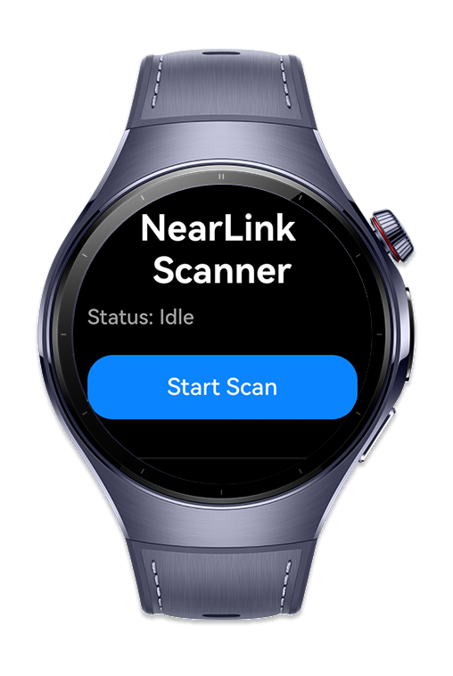
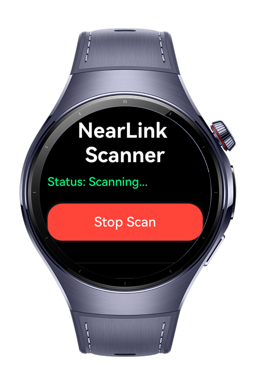
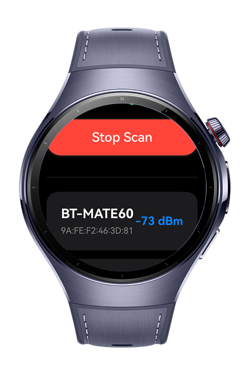
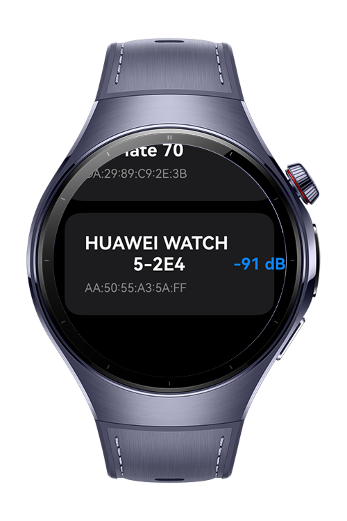

> **Note:** To access all shared projects, get information about environment setup, and view other guides, please visit [Explore-In-HMOS-Wearable Index](https://github.com/Explore-In-HMOS-Wearable/hmos-index).

# How To Scan Nearby Devices With NearLink

This HarmonyOS application utilizes the NearLink Kit to perform real-time scanning and discovery of nearby devices. It features a modern, scrollable dark-mode interface that displays device names, MAC addresses, and signal strength (RSSI) for efficient monitoring.
# Preview

<div>    
  
  
  
  
</div>

# Use Cases

- **NearLink Hardware Debugging**: Verifying that NearLink modules or prototypes are correctly advertising and visible to other devices during development.
- **Signal Coverage Analysis**: Monitoring RSSI (dBm) values to assess signal range, connection quality, and potential interference in the environment.
- **IoT Device Discovery**: Quickly identifying and listing NearLink-enabled sensors, controllers, and smart home devices within the immediate vicinity.


# Tech Stack

- **Languages**: ArkTS
- **Frameworks**: HarmonyOS SDK 5.1.0(18)
- **Tools**: DevEco Studio Vers 5.1.0.842
- **Libraries**: @kit.PerformanceAnalysisKit, @kit.BasicServicesKit, @kit.NearLinkKit, @kit.ArkUI, @kit.AbilityKit


# Directory Structure

```
│   module.json5
│
├───ets
│   ├───entryability
│   │       EntryAbility.ets
│   │
│   ├───entrybackupability
│   │       EntryBackupAbility.ets
│   │
│   └───pages
│           Index.ets
│
└───resources
    ├───base
    │   ├───element
    │   │       color.json
    │   │       float.json
    │   │       string.json
    │   │
    │   ├───media
    │   │       background.png
    │   │       foreground.png
    │   │       layered_image.json
    │   │       startIcon.png
    │   │
    │   └───profile
    │           backup_config.json
    │           main_pages.json
    │
    ├───dark
    │   └───element
    │           color.json
    │
    └───rawfile

```

# Constraints and Restrictions
## Supported Devices
- Huawei Watch 5
## Request Permissions

- ACCESS_NEARLINK


# License
**How To Scan Nearby Devices With NearLink** is distributed under the terms of the **MIT License**
See the [LICENSE](LICENSE) for more information.


